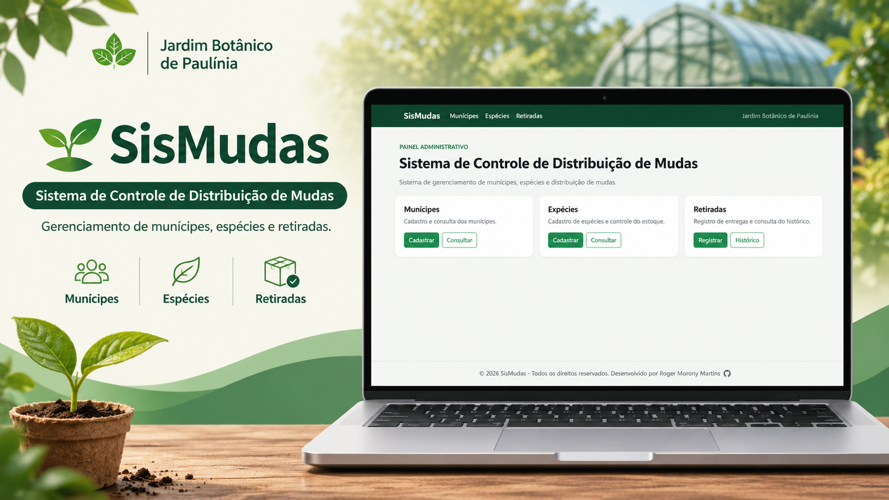

  

# SisMudas 🌱

**Sistema de Controle de Distribuição de Mudas**

O **SisMudas** é um projeto acadêmico desenvolvido para facilitar o acompanhamento da distribuição gratuita de mudas. Sua proposta foi inspirada no processo de atendimento do **Jardim Botânico de Paulínia (SP)**, reunindo em um único lugar o cadastro de moradores, as espécies disponíveis e o histórico das retiradas.

A ideia é tornar esse controle mais prático, permitindo consultar informações com facilidade e acompanhar a quantidade de mudas disponíveis para distribuição.

## O que o SisMudas permite fazer?

- **Munícipes:** cadastrar moradores e consultar ou atualizar seus dados.
- **Espécies:** cadastrar as espécies de mudas e acompanhar a quantidade disponível em estoque.
- **Retiradas:** registrar as mudas entregues a cada morador e consultar o histórico.
- **Controle de distribuição:** verificar o limite de até **5 mudas por munícipe a cada 30 dias**.
- **Atualização do estoque:** ajustar as quantidades disponíveis conforme as retiradas são registradas, corrigidas ou excluídas.

## Como funciona?

Primeiro, o morador é cadastrado no sistema. Depois, são selecionadas as espécies e as quantidades desejadas. O SisMudas registra a retirada, verifica o limite de distribuição e atualiza o estoque.

As informações ficam disponíveis para consulta, ajudando no acompanhamento das entregas e na organização do atendimento.

## Conheça o projeto

🌐 **[Acessar o SisMudas](https://sismudas.onrender.com)**

💻 **[Ver o projeto no GitHub](https://github.com/rogermorony/SisMudas-controle-de-mudas)**

> **Observação:** o SisMudas é um projeto acadêmico demonstrativo, não um sistema oficial do Jardim Botânico de Paulínia. Na versão pública, devem ser utilizados apenas dados fictícios.

## Desenvolvimento

Desenvolvido por **Roger Morony Martins**, como projeto acadêmico da disciplina de **Desenvolvimento Back-End**, do **Instituto Federal Sul-rio-grandense (IFSul)**.
